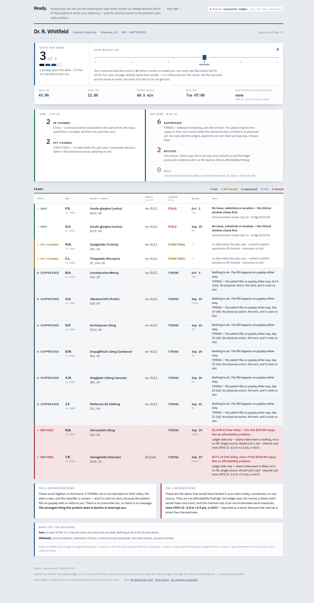
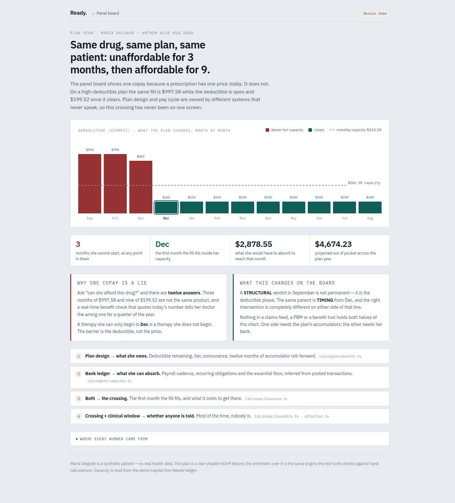

# TrueCost

**Live demo: [truecost.health](https://truecost.health)** · Built at **VTHacks 14** (Virginia Tech, Sep 2026, 36 hours) by Aditya Banerjee and JC Valencia

About 27% of new prescriptions in the U.S. are never filled, and the alert a doctor gets
("patient didn't pick it up") looks the same whether the patient will fill it on Friday's
payday, will run out of time first, or can't afford it at all this year. Those need opposite
responses.

TrueCost reads a patient's bank transactions (through Capital One's Nessie API) and computes
the **Ready Day**: the earliest date their cash flow covers the copay without pushing a bill
they already owe into the red. From that one date it sorts each unfilled prescription into:

| Class | What's happening | Right response |
|---|---|---|
| **TIMING** | Can afford it, just not this week | Nothing. The alert is suppressed. |
| **STALE** | Can afford it, but not before the clinical window closes | Doctor decides: re-issue, substitute, escalate |
| **STRUCTURAL** | No day this plan year when it clears | Patient assistance or a different therapy |

Then it **refuses most alerts**. Only alerts confirmed by two independent sources (no-fill
claim + bank ledger) are sent, within a weekly budget derived from the doctor's own
engagement history. The refusals are shown on screen next to the sends.



## How it works

- **Deterministic engine, no LLM in the decision path.** TypeScript, strict mode.
- **Capital One Nessie API** across six endpoint families: deposits (payday cadence), purchases
  and merchants (recurring spend), bills (dated obligations), plus real writes across two
  sandbox customers.
- **773 test assertions**, each expected value hand-computed in a comment above it.
- **Next.js 15** app with nine routes, deployed with CI/CD on every push.
- A live → recorded → demo fallback chain, so the app runs with no API key at all.

| Route | What it shows |
|---|---|
| `/` | Panel board: 12 candidates, sent vs. suppressed vs. refused, with a budget slider |
| `/card/<ref>` | One patient: the Ready Day window, the bill it would displace, the full derivation |
| `/plan-year` | Plan cost vs. bank capacity over 12 months, showing when the deductible changes the verdict |
| `/average-american` | The same question for a median U.S. household and the 14 most-prescribed drugs |
| `/exchange` | The business model, framed as the experiment that would test it |
| `/sticker-shock` | A three-question consumer version |



## Run it

```bash
npm install
npm run dev        # http://localhost:3100 (no keys needed; uses recorded data)
npm test           # 773 assertions
npm run typecheck
```

To run against the live Nessie sandbox, copy `.env.example` to `.env` and add your own key.

## What's real and what isn't

- **Real:** the Nessie integration (reads and writes), the adjudication engine, the plan-year
  math, and the test suite.
- **Synthetic:** every patient (no real health data), the doctor engagement history, the
  formulary and copays, and the median household's bank account (seeded to published Census
  and BEA figures). Modelled constants are labelled `MODELLED` in the code.
- The Ready Day is a projection over about five weeks of transactions, so it's shown as a
  window, not a guaranteed date. There is no backtest.

More detail: [docs/HARDENING.md](docs/HARDENING.md) (what a hostile review broke and how we
fixed it), [docs/REGULATORY.md](docs/REGULATORY.md) (design changes forced by AKS, FCRA and
HIPAA), [docs/FACTS.md](docs/FACTS.md) (sources for every number).

## Team

- **Aditya Banerjee**: adjudication engine, Ready Day / classifier, plan-year crossing, test suite
- **JC Valencia**: Nessie seeding and live-API fixes, median-household segment, second Nessie customer, Price Shock, deploy workflow
